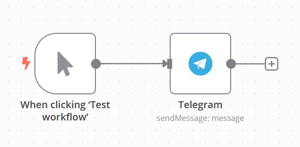

# Блок 1: Telegram-уведомления

**Цель:** Отправка сообщения в Telegram по ручному триггеру.

## Как это работает
1. В Telegram через `@BotFather` создается бот и получается токен (Bot Token).
2. В n8n создается Credential типа `Telegram API` с этим токеном.
3. Workflow состоит из двух узлов: `Manual Trigger` и `Telegram (Send Message)`.
4. В узле Telegram указывается Chat ID получателя и текст сообщения.

## Секреты
Токен хранится только в n8n Credentials. В репозиторий попадает только `.env.example`.

## Импорт
Загрузите файл `workflows/01-telegram-notify.json` в n8n через меню `Import from file`. Вам потребуется создать своего бота и указать свой Credential и Chat ID.

