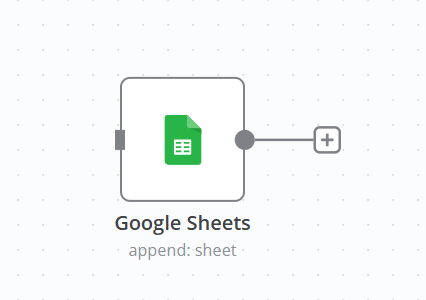

# Блок 2: Google Sheets

**Цель:** Добавление новой строки в Google-таблицу.

## Как это работает
1. Создается проект в Google Cloud, включаются API (Sheets и Drive).
2. Настраивается OAuth2 credential (Client ID, Client Secret, Redirect URI).
3. Workflow: `Manual Trigger` → `Google Sheets (Append Row)`.
4. В узле выбирается таблица, лист и маппятся колонки (Name, Date, Status).

## Секреты
Client ID, Client Secret и токены хранятся в n8n Credentials. В репозиторий не попадают.

## Импорт
Загрузите `workflows/02-google-sheets.json`. Создайте свой OAuth2 credential в n8n и укажите ID своей Google-таблицы.

