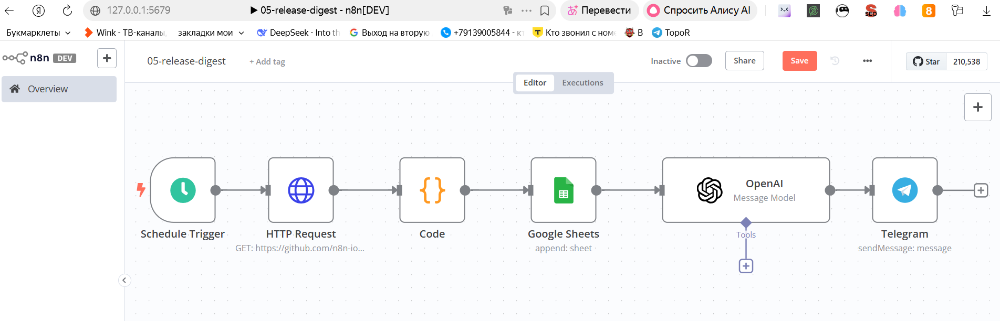

# Блок 5: Сборка (Release Digest)

**Цель:** Автоматический сбор релизов n8n, запись в таблицу и отправка саммари в Telegram.

## Как это работает
1. `Schedule Trigger` запускается каждый час.
2. `HTTP Request` получает Atom-фид с релизами n8n (`releases.atom`).
3. `Code` парсит фид и извлекает последние 3 релиза (Title, Date).
4. `Google Sheets` записывает данные в таблицу.
5. `OpenAI` (опционально) делает краткое саммари.
6. `Telegram` отправляет сообщение с саммари в чат.

## Импорт
Загрузите `workflows/05-release-digest.json`. Подключите свои Credential: Google Sheets, OpenAI (опционально), Telegram.

