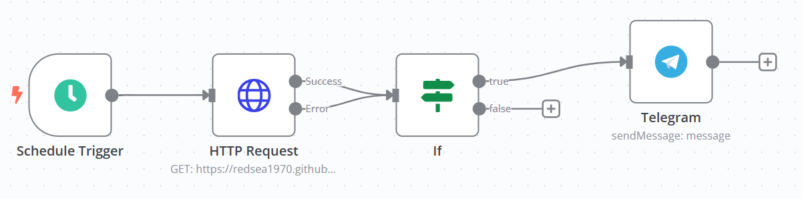

# Блок 6: Мониторинг сайтов (Uptime Monitor)

## Описание
Workflow проверяет доступность сайта каждые 5 минут. Если сайт недоступен (код ответа не 200 или таймаут), отправляется уведомление в Telegram.

## Логика
1. **Schedule Trigger** — запуск каждые 5 минут.
2. **HTTP Request** — GET-запрос к https://redsea1970.github.io (таймаут 10 сек, Continue On Fail).
3. **IF** — проверка: statusCode != 200 ИЛИ есть ошибка (error не пустой).
4. **Telegram** — отправка сообщения «Сайт лёг! Код: X» в чат 5110100663.

## Скриншот

